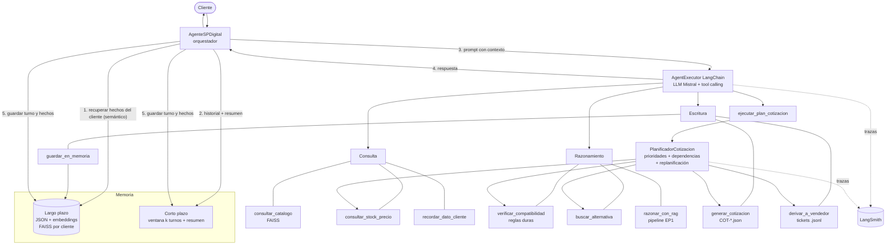
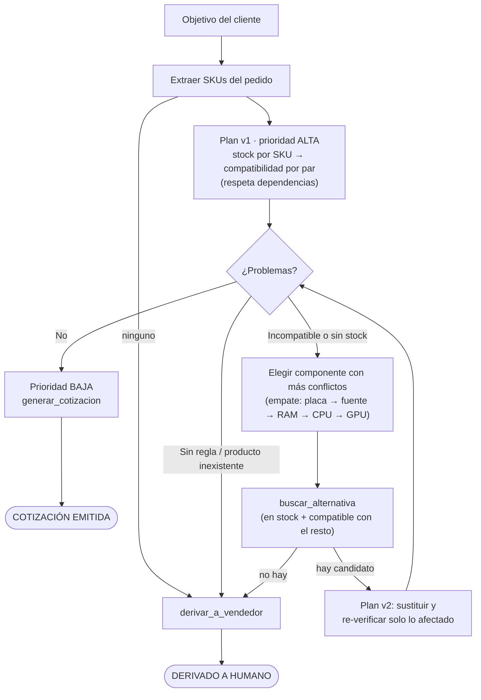
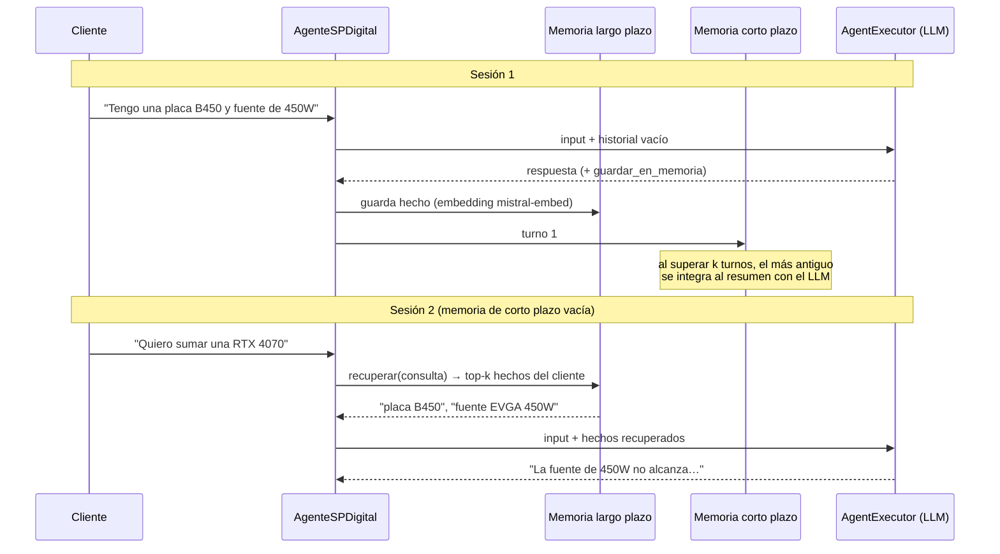

# 🛒 Asistente Técnico de Compatibilidad de Hardware (RAG + Agente) — Caso SP Digital

**Asignatura:** Ingeniería de Soluciones con IA (ISY0101)  
**Evaluaciones:** Evaluación Parcial N°1 (RAG) y Evaluación Parcial N°2 (Agente funcional)  
**Integrantes:** Aaron Gonzalez Rojas, Juan Montero Henao  

## 📌 Descripción del Proyecto
En este proyecto desarrollamos un asistente basado en LLM para la tienda SP Digital. El objetivo es automatizar las respuestas a consultas técnicas sobre compatibilidad entre componentes de PC (placas madre, procesadores, tarjetas de video, RAM y fuentes de poder).

- **EP1 – RAG:** un pipeline RAG híbrido que cruza la información recuperada de un catálogo vectorial con un validador de reglas de negocio, para evitar alucinaciones. Si falta información, deriva a un vendedor humano. LangSmith da trazabilidad y evaluación.
- **EP2 – Agente funcional:** sobre ese RAG construimos un **agente** con herramientas de consulta, razonamiento y escritura, **memoria de corto y largo plazo**, y un **planificador** que ajusta su comportamiento cuando cambian las condiciones (incompatibilidad, falta de stock).

## 🏗️ Arquitectura

### EP1 – Pipeline RAG (se mantiene intacto y se reutiliza como herramienta del agente)

```text
[Consulta del Usuario]
       │
       ▼
[1. Búsqueda Vectorial (FAISS + Mistral Embeddings)]
       │
       ▼
[2. Generación de Respuesta (Ministral-8b via API)]
       │
       ▼
[3. Motor de Validación de Reglas de Negocio]
       ├── ▶ ¿Coincide con regla de compatibilidad? ──▶ [Respuesta Verificada]
       └── ▶ ¿Falta dato o no hay regla? ──▶ [Derivación a Vendedor Humano]
```

### EP2 – Diagrama de orquestación de componentes



### Flujo del planificador (IL2.3)



### Flujo de memoria entre sesiones (IL2.2)



## 🧩 Cómo se cumple cada indicador de la pauta (EP2)

| Indicador | Dónde está | Evidencia |
|---|---|---|
| **IL2.1 / IE1** Herramientas con autonomía | 10 herramientas en `proyecto.ipynb` (consulta, razonamiento, escritura, planificación). El LLM elige cuál usar; ninguna lanza excepciones, devuelven el error como texto | Demo 3 y evaluación del agente |
| **IL2.1 / IE2** Framework adecuado | LangChain (`create_openai_tools_agent` + `AgentExecutor`) sobre Mistral vía API compatible con OpenAI | Sección *Justificación de componentes* |
| **IL2.2 / IE3** Memoria | `MemoriaCortoPlazo` (ventana + resumen) y `MemoriaLargoPlazo` (persistente en JSON) | Demo 2; pruebas de memoria |
| **IL2.2 / IE4** Recuperación semántica | `MemoriaLargoPlazo.recuperar`: embeddings `mistral-embed` + FAISS, aislado por cliente | Demo 2 (sesión 2 recuerda el equipo del cliente) |
| **IL2.3 / IE5** Planificación | `PlanificadorCotizacion`: `PlanStep` con prioridad y dependencias, replanificación reactiva | Demo 1 (casos A–D) y tabla del plan |
| **IL2.4 / IE6, IE8** Documentación | Este README, diagramas Mermaid, comentarios en el cuaderno | — |
| **IE7** Decisiones adaptativas | Casos B, C y D de la Demo 1 | Bitácora de decisiones (`🧭 Decisión: …`) |
| **IE9** Justificación de componentes | Tabla siguiente | — |

## 🔧 Herramientas del agente

| Tipo | Herramienta | Descripción |
|---|---|---|
| Consulta | `consultar_catalogo` | Búsqueda vectorial FAISS (reutiliza `recuperar_contexto` de EP1) |
| Consulta | `consultar_stock_precio` | Existencia, stock y precio simulados en CLP |
| Consulta | `recordar_dato_cliente` | Recuperación semántica en memoria de largo plazo |
| Razonamiento | `verificar_compatibilidad` | Validador de reglas duras para un par de SKUs |
| Razonamiento | `buscar_alternativa` | Reemplazo en stock compatible con el resto de la configuración |
| Razonamiento | `razonar_con_rag` | Pipeline RAG completo de EP1 (`ejecutar_pipeline_rag`) |
| Escritura | `generar_cotizacion` | Valida y escribe `datos_agente/cotizaciones/COT-*.json` |
| Escritura | `derivar_a_vendedor` | Ticket en `datos_agente/derivaciones_vendedor.jsonl` |
| Escritura | `guardar_en_memoria` | Persiste un hecho del cliente |
| Planificación | `ejecutar_plan_cotizacion` | Delegar pedidos multi-componente en el planificador |

## 🧠 Memoria

- **Corto plazo:** guarda los últimos *k* turnos. Cuando un turno sale de la ventana, el LLM lo integra a un **resumen acumulado** (si el LLM falla, se usa un resumen simple de respaldo). Equivale a combinar las estrategias *Window* y *Summary* vistas en el RA2 (IL2.2).
- **Largo plazo:** cada hecho (equipo, presupuesto, uso) se guarda con su embedding en `datos_agente/memoria_largo_plazo.json`. En cada consulta se recuperan los hechos más cercanos **solo del mismo cliente**. El agente los guarda con la herramienta `guardar_en_memoria`; si no la usa, un respaldo determinista guarda las frases declarativas ("tengo…", "mi presupuesto…") tal como las dijo el cliente.

## 🗓️ Planificación y decisiones adaptativas

El planificador es **determinista y sin LLM**, así cada decisión es reproducible y auditable en la bitácora:

1. **Jerárquico:** objetivo → pasos `consultar_stock_precio` y `verificar_compatibilidad` (prioridad ALTA, con dependencias) → `generar_cotizacion` (prioridad BAJA).
2. **Priorizado:** en cada ciclo se ejecuta el paso listo de mayor prioridad.
3. **Reactivo:** ante una incompatibilidad o falta de stock se elige el componente con más conflictos, se busca una alternativa y se **replanifica** (v2, v3… máximo 3). Sin alternativa o sin regla → derivación a humano.

| Caso (Demo 1) | Condición | Decisión del agente |
|---|---|---|
| A | Configuración AM5 compatible | Cotiza directo (plan v1) |
| B | CPU AM5 + placa AM4 + RAM DDR5 | Reemplaza la placa B450 por la B650 (plan v2) |
| C | RTX 4070 + fuente 450W | Reemplaza la fuente por la Corsair 650W (plan v2) |
| D | RAM DDR4 sin stock y sin alternativa compatible | Deriva a vendedor humano |

## ⚖️ Justificación de componentes (IE9)

| Decisión | Alternativas | Por qué esta |
|---|---|---|
| **LangChain** (`AgentExecutor`, tool calling) | CrewAI, Haystack, AutoGen | El problema es **un agente con herramientas y memoria**, no un equipo de roles; LangChain integra directo con nuestro cliente OpenAI-compatible, con LangSmith (ya usado en EP1) y con FAISS. CrewAI se justifica cuando hay varios agentes colaborando; aquí añadiría complejidad sin beneficio |
| **Mistral (`ministral-8b-latest`)** | Otros modelos | Mantiene el modelo y la key de EP1; soporta function calling. Se puede cambiar con `LLM_MODEL_AGENTE` |
| **Validador de reglas duras** dentro de las herramientas | Confiar en el LLM | En EP1 el LLM se contradijo con las reglas (coincidencia 60 %); los datos críticos (compatibilidad, stock, cotización) no deben depender de un modelo |
| **Planificador determinista** | Plan generado por el LLM | Un modelo de 8B puede producir planes inconsistentes; el planificador garantiza orden, prioridades y trazabilidad. El LLM se reserva para interpretar el pedido y redactar |
| **Memoria de largo plazo en JSON + FAISS** | Base vectorial externa | Es simple, portable y suficiente para el prototipo. Para escalar basta cambiar la clase `MemoriaLargoPlazo` por una base vectorial persistente (Chroma, pgvector) sin tocar el agente |
| **Ventana + resumen** (corto plazo) | Buffer completo | El buffer completo crece sin límite; la ventana con resumen controla tokens y conserva datos antiguos |
| **Herramientas que no lanzan excepciones** | Propagar errores | Una excepción tumba al agente; devolver el error como texto le permite reaccionar |

**Escalabilidad y compatibilidad:** cada herramienta es una función independiente registrada en `TOOLS_AGENTE`; agregar una (p. ej. consulta a un ERP real) no requiere cambiar el orquestador. El proveedor se configura por variables de entorno (`LLM_BASE_URL`, `LLM_MODEL_AGENTE`).

## 🛠️ Herramientas y Tecnologías
- **Lenguaje:** Python 3.10+
- **LLM:** `ministral-8b-latest` (API de Mistral AI)
- **Agente:** LangChain (`langchain-core`, `langchain-openai`, `langchain-classic`)
- **Buscador Vectorial:** FAISS (`faiss-cpu`) con embeddings `mistral-embed`
- **Monitoreo y Evaluación:** LangSmith
- **Entorno:** Jupyter Notebook / Visual Studio Code

## 🚀 Cómo ejecutar nuestro proyecto

### 1. Clonar el repositorio
```bash
git clone https://github.com/imQuasar/asistente-hardware-rag-sp-digital.git
cd asistente-hardware-rag-sp-digital
```

### 2. Crear entorno virtual (Recomendado)

En Windows:
```bash
python -m venv venv
.\venv\Scripts\activate
```

En Mac/Linux:
```bash
python3 -m venv venv
source venv/bin/activate
```

### 3. Instalar librerías
```bash
pip install -r requirements.txt
```

### 4. Configurar las API Keys (.env)
Copia `.env.example` como `.env` y completa tus claves:

```bash
LLM_API_KEY=mstrl_tu_api_key_de_mistral
LANGSMITH_API_KEY=lsv2_pt_tu_api_key_de_langsmith
LANGSMITH_PROJECT=SP-Digital-RAG-Evaluation
```

> ⚠️ **Nota de seguridad:** el `.env` está en el `.gitignore` para no subir las claves reales a GitHub. Si una clave se llegó a publicar o compartir, hay que **revocarla y generar una nueva**.

## 🧪 Ejecución paso a paso
Abre `proyecto.ipynb` en VS Code, selecciona el entorno de Python y ejecuta las celdas en orden (**Run All**).

**Parte 1 – RAG (EP1)**
1. Carga el catálogo de prueba y las reglas de negocio.
2. Crea el índice FAISS y vectoriza los textos.
3. Define el pipeline RAG con los decoradores de LangSmith.
4. Muestra un test de precisión local.
5. Sube la evaluación RAG formal a LangSmith.

**Parte 2 – Agente (EP2)**
6. Configura el agente, el inventario simulado y las reglas extendidas.
7. Define las memorias de corto y largo plazo.
8. Define las 10 herramientas y el planificador.
9. Crea el agente LangChain y el orquestador `AgenteSPDigital`.
10. **Demo 1** (planificación, sin LLM), **Demo 2** (memoria entre sesiones) y **Demo 3** (agente completo).
11. **Pruebas automáticas** (18 pruebas sin API) y **evaluación del agente** con LLM.

> Mistral puede responder 429 (límite de peticiones). El código reintenta solo con `llamar_con_espera`; si sucede mucho, vuelve a ejecutar la celda.

## 📊 Evaluación
**EP1 (LangSmith):** Context Recall, Faithfulness (LLM-as-a-Judge) y Verdict Accuracy sobre `DATASET_EVALUACION`, con latencia y costo de tokens en el proyecto `SP-Digital-RAG-Evaluation`.

**EP2:**
- **Pruebas de software (18, sin API):** reglas simétricas, no regresión de las reglas originales, extracción de SKUs, stock, alternativas, cotización (rechaza inválidas), tickets, ventana/resumen, persistencia/aislamiento/semántica de la memoria y los 5 escenarios del planificador (incluidas prioridades y dependencias).
- **Evaluación del agente (con LLM):** *selección de herramienta correcta* y *decisión final correcta* sobre 5 casos. Cada ejecución queda trazada en LangSmith.

## 📁 Qué hay en este repo

```bash
├── proyecto.ipynb      # Cuaderno principal: RAG (EP1) + agente, memoria, planificación y pruebas (EP2)
├── requirements.txt    # Dependencias
├── .env.example        # Plantilla de variables de entorno
├── .gitignore          # Ignora .env y la carpeta datos_agente/
├── datos_agente/       # (se genera al ejecutar) cotizaciones, tickets y memoria de largo plazo
└── README.md           # Este documento
```

## 🤖 Declaración de uso de IA
Se utilizó un asistente de IA (Claude, de Anthropic) como apoyo para estructurar e implementar el código del agente, generar los diagramas Mermaid y redactar esta documentación técnica a partir del RA2 del curso. El equipo revisó y ejecutó el código. *(Completar con el detalle final de uso.)* Las **reflexiones individuales y conclusiones del informe deben ser redactadas por cada integrante sin apoyo de IA**, según la pauta.

## 📚 Referencias (APA 7)
- CrewAI. (s. f.). *CrewAI documentation*. https://docs.crewai.com
- Johnson, J., Douze, M., & Jégou, H. (2021). Billion-scale similarity search with GPUs. *IEEE Transactions on Big Data, 7*(3), 535–547. https://doi.org/10.1109/TBDATA.2019.2921572
- LangChain. (s. f.). *LangChain documentation*. https://docs.langchain.com
- LangChain. (s. f.). *LangSmith documentation*. https://docs.smith.langchain.com
- Lewis, P., Perez, E., Piktus, A., Petroni, F., Karpukhin, V., Goyal, N., Küttler, H., Lewis, M., Yih, W., Rocktäschel, T., Riedel, S., & Kiela, D. (2020). Retrieval-augmented generation for knowledge-intensive NLP tasks. *Advances in Neural Information Processing Systems, 33*, 9459–9474.
- Meta AI. (s. f.). *FAISS: A library for efficient similarity search* [Repositorio]. GitHub. https://github.com/facebookresearch/faiss
- Mistral AI. (s. f.). *Mistral AI documentation*. https://docs.mistral.ai
- Packer, C., Wooders, S., Lin, K., Fang, V., Patil, S. G., Stoica, I., & Gonzalez, J. E. (2023). *MemGPT: Towards LLMs as operating systems* [Preprint]. arXiv. https://arxiv.org/abs/2310.08560
- Valenzuela, F. (s. f.). *Ingeniería de Soluciones con Inteligencia Artificial, RA2: Desarrollo de agentes inteligentes* [Repositorio]. GitHub. https://github.com/fvalenzuelag/Ingenier-a-de-Soluciones-con-Inteligencia-Artificial
- Yao, S., Zhao, J., Yu, D., Du, N., Shafran, I., Narasimhan, K., & Cao, Y. (2023). ReAct: Synergizing reasoning and acting in language models. *International Conference on Learning Representations (ICLR 2023)*. https://arxiv.org/abs/2210.03629

## ✍️ Reflexión individual
*(Cada integrante redacta aquí, sin apoyo de IA, su aprendizaje y contribución al proyecto.)*

- **Aaron Gonzalez Rojas:**
- **Juan Montero Henao:**
